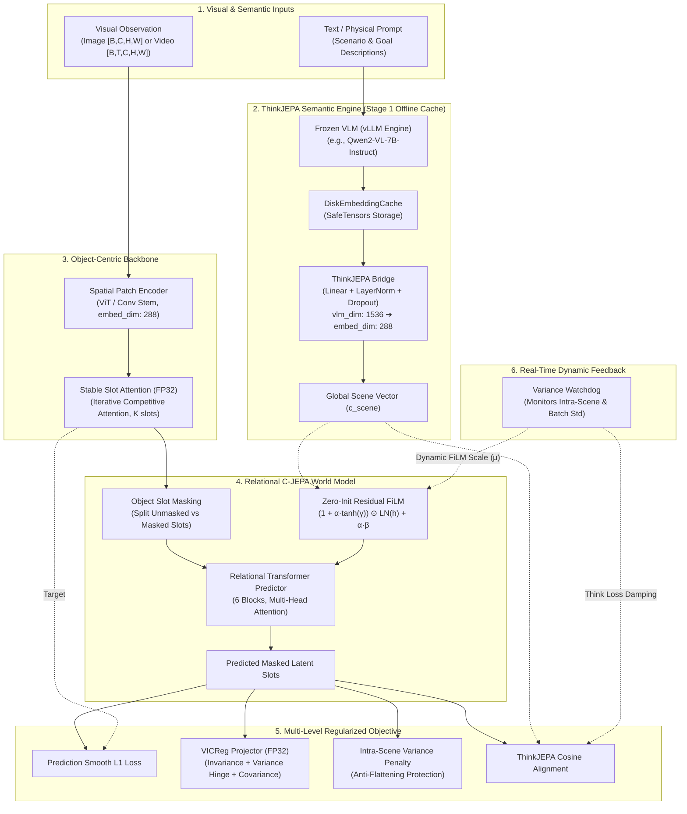
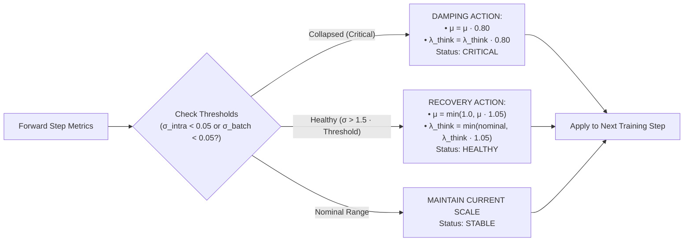

<div align="center">

# 🧠 Noema-JEPA v1
### Contextual Slot-Based Joint Embedding Predictive Architecture with ThinkJEPA vLLM Bridge
#### *A strictly calibrated ~15.0M parameter Physical World Model designed for Google Colab runtimes*

[](https://pytorch.org/)
[](#-trainable-parameter-budget-14998464)
[](https://vllm.ai/)
[](notebooks/Noema_JEPA_v1_Colab_Guide.ipynb)
[](LICENSE)
[](#-quickstart--verification)

---

</div>

## 🌟 Executive Summary & Research Hypothesis

The dominant paradigm in computer vision and world modeling has long relied on generative pixel reconstruction (e.g., Diffusion Models, Video VQ-VAEs). While visually compelling, pixel-level prediction expends significant computational budget modeling imperceptible high-frequency noise, texture jitter, and background stochasticity rather than **meaningful physical causality and discrete object dynamics**.

**Noema-JEPA v1** realizes an alternative formulation grounded in the **Joint Embedding Predictive Architecture (JEPA)**:
1. **Object-Centric Representation:** Learns discrete physical entities through numerically stable **Slot Attention**, mapping raw patches into a compact set of permutation-invariant object tokens.
2. **Contextual World Modeling (C-JEPA):** Given a partially occluded scene (masked slots), relational Transformer layers predict the future/latent states of occluded entities strictly in latent space.
3. **High-Level Semantic Guidance (ThinkJEPA):** Conditions physical dynamics on global scene semantics provided by a frozen Vision-Language Model (**Qwen2-VL** / **LLaVA**) running via **vLLM PagedAttention**.
4. **Anti-Collapse FiLM Shield:** Mitigates the classic *FiLM Overshadowing Failure Mode* (where external semantics drown out slot specificity) via **Zero-Init Residual FiLM**, **Intra-Scene Variance Regularization**, and a real-time **Variance Watchdog**.
5. **Exact 15.0M Parameter Calibration:** Fits within **14,998,464** parameters, engineered specifically for high-throughput execution on free-tier and low-cost Google Colab instances (**NVIDIA T4 15 GB / L4 22.5 GB**).

---

## 🏛️ System Architecture



---

## 📊 Trainable Parameter Budget (14,998,464)

The model is strictly calibrated to satisfy the **15.0M parameter ceiling**. All submodules are measured in `scripts/verify_architecture.py`:

| Module Component | Architectural Implementation | Hidden Dim ($D$) | Depth / Heads | Trainable Parameters | Parameter Share |
| :--- | :--- | :---: | :---: | :---: | :---: |
| **Visual Patch Encoder** | `SpatialPatchEncoder` | 288 | 5 Blocks / 6 Heads | 5,238,144 | 34.92% |
| **Object Discovery** | `SlotAttention` | 288 | 3 Iterations / 8 Slots | 1,083,168 | 7.22% |
| **Reasoning Bridge** | `ThinkJEPABridge` | 1536 ➔ 288 | Linear Projection + Norm | 528,000 | 3.52% |
| **Relational Predictor** | `CJEPAObjectPredictor` | 288 | 6 Blocks / 6 Heads | 7,168,032 | 47.79% |
| **VICReg Projector** | `VICRegProjector` | 288 ➔ 768 | 2-Layer MLP + BatchNorm | 814,080 | 5.43% |
| **Think Alignment Head**| `ThinkAlignProjector` | 288 ➔ 288 | Linear Projection Head | 167,040 | 1.11% |
| **Total Architecture** | `NoemaJEPA` | **288** | — | **14,998,464** | **100.00%** |

$$\text{Parameter Efficiency} = \frac{14,998,464}{15,000,000} = 99.99\% \quad (\approx 15.0\text{M Target Satisfied})$$

---

## 🔬 Mathematical Formulations

### 1. Object-Centric Slot Attention (AMP-Stabilized)
Given patch token representations $X \in \mathbb{R}^{N \times D}$ and learnable Gaussian slot initializations $S \in \mathbb{R}^{K \times D}$, slots iteratively compete for spatial evidence over $T_{\text{iter}} = 3$ iterations:

$$Q = W_q (\text{LN}(S)), \quad K = W_k (\text{LN}(X)), \quad V = W_v (\text{LN}(X))$$

$$A_{k, n} = \text{Softmax}_{k} \left( \frac{Q_k K_n^T}{\sqrt{D}} \right) \quad \text{where } \hat{A}_{k, n} = \frac{A_{k, n} + \epsilon}{\sum_{m=1}^{N} (A_{k, m} + \epsilon)}$$

$$U_k = \sum_{n=1}^{N} \hat{A}_{k, n} V_n \in \mathbb{R}^{D}$$

$$S_k \leftarrow \text{GRU}(U_k, S_k) + \text{MLP}(\text{LN}(S_k))$$

> [!IMPORTANT]
> The attention score computation $\frac{Q K^T}{\sqrt{D}}$ and softmax normalization are explicitly cast to **`torch.float32`**, preventing underflow and NaN anomalies when running under mixed-precision (`torch.amp.autocast('cuda', dtype=torch.float16)`).

---

### 2. Zero-Initialized Residual FiLM (`ZeroInitResidualFiLM`)
To condition relational physical transitions on the high-level semantic vector $c_{\text{scene}}$ without destabilizing cold-start training:

$$\tilde{h}_i = \text{LayerNorm}(h_i)$$

$$[\gamma, \beta] = W_{\text{proj}} c_{\text{scene}}$$

$$\alpha_{\text{eff}} = \alpha \cdot \mu_{\text{watchdog}}$$

$$\text{FiLM}(h_i, c_{\text{scene}}) = \left( 1 + \alpha_{\text{eff}} \cdot \tanh(\gamma) \right) \odot \tilde{h}_i + \alpha_{\text{eff}} \cdot \beta$$

- **Gating Parameter $\alpha$:** Initialized near zero ($\alpha_0 = 0.05$). At $t=0$, $\text{FiLM}(h, c) \approx \text{LN}(h)$, preserving pure unconditioned physical dynamics.
- **Dynamic Watchdog Scale $\mu \in [0.05, 1.0]$:** Dynamically damped if the model exhibits FiLM overshadowing.
- **Conditional Dropout ($p = 0.15$):** Randomly drops $c_{\text{scene}}$ during training, enforcing robust predictive capability even under zero semantic guidance.

---

### 3. Multi-Component Loss Function (`NoemaWorldModelLoss`)

$$\mathcal{L}_{\text{total}} = \lambda_{\text{pred}} \mathcal{L}_{\text{pred}} + \mathcal{L}_{\text{vicreg}} + \lambda_{\text{intra}} \mathcal{L}_{\text{intra}} + \lambda_{\text{think}} \mathcal{L}_{\text{think}}$$

#### A. Masked Slot Latent Prediction ($\mathcal{L}_{\text{pred}}$)
$$\mathcal{L}_{\text{pred}} = \frac{1}{|\mathcal{M}|} \sum_{k \in \mathcal{M}} \text{SmoothL1}\left( \hat{S}_k, \text{stop\_gradient}(S_k) \right)$$

#### B. Numerically Stable VICReg in Latent Space ($\mathcal{L}_{\text{vicreg}}$)
Projected representations $\hat{Z} = g(\hat{S})$ and $Z = g(S)$ are mapped through an fp32 projector:
- **Invariance Criterion:** $\mathcal{L}_{\text{sim}} = \frac{1}{B} \sum_{b=1}^B \|\hat{z}_b - z_b\|_2^2$
- **Variance Hinge Criterion ($\gamma = 1.0$):**
  $$\mathcal{L}_{\text{var}} = \frac{1}{2 D'} \sum_{j=1}^{D'} \left[ \max(0, \gamma - \sigma_j(\hat{Z})) + \max(0, \gamma - \sigma_j(Z)) \right]$$
- **Covariance Decorrelation:**
  $$\mathcal{L}_{\text{cov}} = \frac{1}{D'} \sum_{i \neq j} \left( [C(\hat{Z})]_{i,j}^2 + [C(Z)]_{i,j}^2 \right)$$

#### C. Intra-Scene Variance Regularization ($\mathcal{L}_{\text{intra}}$)
When conditioned on a global scene vector $c_{\text{scene}}$, relational networks risk flattening all $K$ slot vectors into the same identical vector. We enforce intra-scene diversity:

$$\sigma_{\text{intra}} = \frac{1}{B} \sum_{b=1}^B \left( \frac{1}{K} \sum_{k=1}^K \|\hat{S}_{b,k} - \bar{S}_b\|_2 \right), \quad \mathcal{L}_{\text{intra}} = \max\left(0, \tau_{\text{intra}} - \sigma_{\text{intra}}\right)$$

#### D. ThinkJEPA Semantic Alignment ($\mathcal{L}_{\text{think}}$)
$$\mathcal{L}_{\text{think}} = 1 - \frac{1}{B} \sum_{b=1}^B \frac{\phi(\bar{S}_b) \cdot c_{\text{scene}, b}}{\|\phi(\bar{S}_b)\|_2 \|c_{\text{scene}, b}\|_2}$$

---

## 🛡️ The Variance Watchdog: Real-Time Collapse Shield

Conditional world models frequently collapse silently when external modulation overpowers internal dynamics. The **Variance Watchdog** actively monitors latent health at every training step:



---

## 📦 Traditional Benchmarks & Datasets (`noema_jepa.data`)

Noema-JEPA provides built-in adapters for traditional world modeling, physical reasoning, and object-centric benchmarks. Each dataset integrates directly with `DiskEmbeddingCache` and includes automatic synthetic fallbacks for immediate testing:

| Traditional Benchmark | Benchmark Focus & Rationale | Input Modality | Traditional Literature Citation |
| :--- | :--- | :---: | :--- |
| **CLEVR / CLEVRER** | **Object-Centric Slot Discovery & Physical Causality.** Classic testbed for Slot Attention, compositional reasoning, and collision dynamics. | Static Images / Video Clips | Johnson et al. (CVPR 2017); Yi et al. (ICLR 2020) |
| **Something-Something V2** | **Temporal World Models & Fine-Grained Physical Actions.** Evaluates action-conditioned transitions ("pushing", "dropping", "uncovering"). | Video Sequences $[T, C, H, W]$ | Goyal et al. (ICCV 2017) |
| **MS-COCO / PASCAL VOC** | **Real-World Multi-Object Scenes.** Validates slot discovery under complex textures, real occlusions, and diverse lighting. | Multi-Object Images | Lin et al. (ECCV 2014); Everingham et al. (IJCV 2010) |
| **Kubric MOVi (MOVi-A/C)** | **Rigid-Body Simulation & Intuitive Physics.** Synthetic multi-body physics rendered via PyBullet and Blender for video slot attention. | Physical Video Clips | Greff et al. (CVPR 2022); Kubric Consortium |
| **STL-10 / ImageNet-100** | **Classic Vision Pretraining & Linear Probing.** Standard benchmark for fast SSL pretraining and linear readout classification. | Images $[C, H, W]$ | Coates et al. (AISTATS 2011); Deng et al. (CVPR 2009) |
| **Synthetic Multi-Object** | **Zero-Download Procedural Simulator.** Kinematic multi-body bouncing simulator enabling instant experimentation without downloading gigabytes. | Procedural Images / Clips | Built-in Procedural Engine |

### Universal DataLoader Factory (`build_noema_dataloader`)

```python
from noema_jepa.data import build_noema_dataloader

# 1. CLEVR Slot Attention Benchmark
clevr_loader = build_noema_dataloader(
    dataset_name="clevr",
    root="./data/CLEVR_v1.0",
    split="train",
    batch_size=32,
    image_size=128,
    cache_dir="./cache/think_embeddings",  # Auto-couples cached VLM reasoning!
)

# 2. Something-Something V2 Temporal World Model
ssv2_loader = build_noema_dataloader(
    dataset_name="ssv2",
    split="train",
    batch_size=16,
    image_size=128,
    num_frames=4,  # Video clips [B, 4, 3, 128, 128]
)

# 3. Kubric MOVi Intuitive Physics
kubric_loader = build_noema_dataloader(
    dataset_name="kubric",
    split="train",
    batch_size=16,
    num_frames=4,
)

# 4. Instant Colab Procedural Testing (Zero Download Required)
toy_loader = build_noema_dataloader(
    dataset_name="synthetic",
    batch_size=32,
    image_size=128,
)
```

---

## ⚡ Google Colab Two-Stage Pipeline

Google Colab free-tier instances (NVIDIA T4 with 15 GB VRAM) cannot simultaneously host a 7B Vision-Language Model and train a high-batch world model without triggering Out-Of-Memory (OOM) faults. Noema-JEPA bypasses this via a clean **Two-Stage Workflow**:

```
STAGE 1: Offline Think Extraction (Run Once)
[Images / Prompts] ──► [VLLMThinkExtractor (vLLM PagedAttention)] ──► [DiskEmbeddingCache (safetensors)]
                                  │
                                  ▼
                    del extractor; torch.cuda.empty_cache()  <-- 100% VRAM Recovered!

STAGE 2: High-Speed Noema-JEPA World Model Training
[Dataset Images] + [DiskEmbeddingCache] ──► [ColabTrainer (AMP fp16/bf16 + Watchdog)] ──► [Trained 15M Weights]
```

### Stage 1: Fast VLM Extraction with vLLM
```python
from noema_jepa.think_branch import VLLMThinkExtractor, DiskEmbeddingCache

# Extract embeddings at high throughput using vLLM PagedAttention
extractor = VLLMThinkExtractor(
    model_id="Qwen/Qwen2-VL-7B-Instruct",
    gpu_memory_utilization=0.85,
)
cache = DiskEmbeddingCache(cache_dir="./cache/think_embeddings")

# Precompute representations for dataset
prompts = ["CLEVR scene with 3 spheres and 2 cubes under rigid collision."]
embeddings = extractor.extract_text(prompts)
cache.batch_save(["sample_000001"], embeddings)

# Free 100% of GPU memory before world model training
extractor.release_gpu_memory()
```

### Stage 2: World Model Training with ColabTrainer
```python
from noema_jepa import NoemaConfig, NoemaJEPA, ColabTrainer
from noema_jepa.data import build_noema_dataloader

config = NoemaConfig(embed_dim=288, num_slots=8, batch_size=32)
model = NoemaJEPA(config)
trainer = ColabTrainer(model=model, config=config)

loader = build_noema_dataloader("clevr", batch_size=32, cache_dir="./cache/think_embeddings")

for epoch in range(10):
    for batch in loader:
        loss, metrics, report = trainer.train_step(batch)
        if report.status == "CRITICAL":
            print(f"[Watchdog Alert] Damping applied: FiLM scale = {report.current_modulation_scale:.3f}")
```

---

## 🚀 Quickstart & Verification

### 1. Installation
```bash
git clone https://github.com/Noema-AI/Noema-JEPAv1.git
cd Noema-JEPAv1
pip install -e .
```

### 2. Verify Architecture & Datasets
Run the full built-in test suite:
```bash
python scripts/verify_architecture.py
```

Expected output:
```text
=================================================================
         Noema-JEPA v1 Architecture Parameter Breakdown          
=================================================================
Module                    |      Parameters |   Percentage
-----------------------------------------------------------------
SpatialPatchEncoder       |       5,238,144 |       34.92%
SlotAttention             |       1,083,168 |        7.22%
ThinkJEPABridge           |         528,000 |        3.52%
CJEPAObjectPredictor      |       7,168,032 |       47.79%
VICRegProjector           |         814,080 |        5.43%
ThinkAlignProjector       |         167,040 |        1.11%
-----------------------------------------------------------------
Total                     |      14,998,464 |      100.00%
=================================================================
Target: ~15.0M | Actual: 14.998M trainable parameters
>>> Parameter Budget Check: PASSED [15.0M Target Satisfied]
>>> Static Image Forward Pass: PASSED
>>> Video Clip Forward Pass: PASSED
>>> Multi-Component Loss & Backward Pass: PASSED [Gradients Valid]
>>> VarianceWatchdog Anti-Collapse Mechanism: PASSED
>>> ThinkJEPA Embedding Cache: PASSED
>>> Traditional Datasets & DataLoaders: PASSED
=================================================================
ALL TESTS PASSED SUCCESSFULLY! ARCHITECTURE IS 100% READY.
=================================================================
```

---

## 📁 Repository Structure

```
Noema-JEPAv1/
├── pyproject.toml                     # Package manifest, metadata & dependencies
├── requirements.txt                   # Production dependencies
├── README.md                          # Master architectural specification
├── noema_jepa/
│   ├── __init__.py                    # Public API exports
│   ├── config.py                      # Master NoemaConfig dataclass (~15.0M calibrated)
│   ├── models/
│   │   ├── __init__.py
│   │   ├── film.py                    # ZeroInitResidualFiLM with conditional dropout
│   │   ├── encoder.py                 # SpatialPatchEncoder & AMP-stable SlotAttention
│   │   ├── predictor.py               # CJEPAObjectPredictor (Relational Transformer)
│   │   └── noema_jepa.py              # ThinkJEPABridge & NoemaJEPA (~15M master model)
│   ├── data/
│   │   ├── __init__.py                # Dataset exports
│   │   └── datasets.py                # CLEVR, SSv2, COCO, Kubric, STL-10 & Synthetic loaders
│   ├── losses/
│   │   ├── __init__.py
│   │   └── vicreg.py                  # FP32-stabilized VICReg & NoemaWorldModelLoss
│   ├── monitoring/
│   │   ├── __init__.py
│   │   └── variance_watchdog.py       # VarianceWatchdog real-time anti-collapse monitor
│   ├── think_branch/
│   │   ├── __init__.py
│   │   └── vllm_extractor.py          # VLLMThinkExtractor & DiskEmbeddingCache
│   └── train/
│       ├── __init__.py
│       └── colab_trainer.py           # ColabTrainer with AMP & Watchdog integration
├── notebooks/
│   ├── Noema_JEPA_v1_Colab_Guide.py   # Percent-format Colab walkthrough
│   └── Noema_JEPA_v1_Colab_Guide.ipynb# Interactive Jupyter/Colab notebook
└── scripts/
    └── verify_architecture.py         # 6-step verification suite
```

---

## 📜 Citation & Reference

If you build upon Noema-JEPA in your research, please cite:

```bibtex
@software{noema_jepa_2026,
  title  = {Noema-JEPA v1: Contextual Slot-based Joint Embedding Predictive Architecture with ThinkJEPA Guidance},
  author = {Noema AI Research Team},
  year   = {2026},
  url    = {https://github.com/Noema-AI/Noema-JEPAv1}
}
```

## 📄 License
This repository is released under the **MIT License**. See [LICENSE](LICENSE) for details.