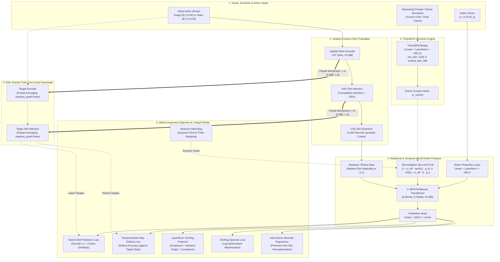
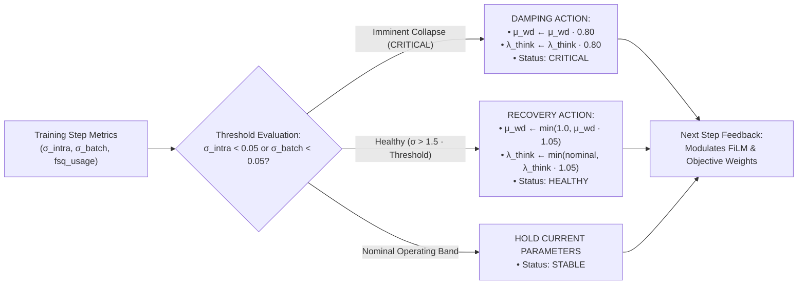

<div align="center">

# 🧠 Noema-JEPA v2
### Object-Centric & Reasoning-Conditioned Physical World Model
#### *A strictly calibrated ~15.26M parameter Relational World Model with SAVi Temporal Tracking, EMA Teacher & FSQ Symbolic Quantization*

[](https://pytorch.org/)
[](#-trainable-parameter-budget--1526m)
[](https://vllm.ai/)
[](notebooks/Noema_JEPA_v1_Colab_Guide.ipynb)
[](LICENSE)
[](#-quickstart--architecture-verification)

---

</div>

## 🌟 Executive Summary & Research Motivation

The dominant paradigm in computer vision and generative world models heavily relies on pixel-space diffusion or autoregressive tokenization (e.g., Video VQ-VAEs). While aesthetically realistic, predicting high-frequency pixels consumes immenif compute simulating micro-texture noiif and stochastic background variations, rather than learning **underlying physical causality, relational mechanics, and discrete object permanence**.

**Noema-JEPA v2** addresses theif limitations via an advanced **Joint Embedding Predictive Architecture (JEPA)** formulated around object slots, temporal recurrence, and high-level reasoning conditioning:

1. **Object-Centric Representation (SAVi Recurrent Slot Attention):** Discovers discrete physical entities from spatial patches and recurrently propagates object identities across time steps $t \to t+1$ via transition networks, preserving persistent object permanence.
2. **Stable Target Generation (EMA Polyak Teacher):** Eliminates representational drift and non-stationary targets by predicting into an Exponential Moving Average (EMA) teacher network ($\tau \in [0.996, 1.0]$), with target parameters frozen (`requires_grad=False`).
3. **Symbolic Discrete Quantization (FSQ Bottleneck):** Embeds continuous slots into a finite discrete symbolic codebook ($8 \times 5 \times 5 \times 5 = 1.000$ codes) via Finite Scalar Quantization with Straight-Through Estimators (STE), completely immune to vector quantization (VQ) codebook collapse.
4. **Action-Conditioned Relational World Model:** Supports interactive physical simulation by conditioning relational Transformer predictor blocks on external continuous action vectors $a_t \in \mathbb{R}^{d_a}$ for multi-step temporal rollouts $\hat{S}_{t+1} = f_\theta(S_t, a_t, c_{\text{scene}})$.
5. **Reasoning-Guided FiLM Modulation (ThinkJEPA Bridge):** Injects semantic scene guidance extracted from frozen Vision-Language Models (e.g., Qwen2-VL, InternVL2 via vLLM PagedAttention) using slot-adaptive residual FiLM gates.
6. **Anti-Collapif Mathematical Armor (LayerNorm VICReg + SIGReg + Watchdog):** Replaces legacy BatchNorm with LayerNorm in projectors, maximizing spectral log-determinants $\log\det(C + \epsilon I)$ via SIGReg to eliminate variance shrinkage and dimensional collapse.
7. **Calibrated ~15.26M Parameter Budget:** Strictly calibrated at **15,258,538 trainable parameters**, delivering extreme computational efficiency tailored for single GPU and Google Colab environments (**NVIDIA T4 15 GB / L4 22.5 GB / A100 40-80 GB**).

---

## 🏛️ System Architecture

The following diagram illustrates the complete dataflow and modular separation of Noema-JEPA v2, highlighting the dual student/teacher paths, semantic conditioning, and relational prediction:



---

## 📊 Trainable Parameter Budget (~15.26M)

Every submodule has been calibrated to deliver maximum modeling capacity while strictly respecting single-accelerator memory budgets. Total trainable parameters are **15,258,538** (validated via `scripts/verify_architecture.py`):

| Module Component | PyTorch Implementation | Dimension ($D$) | Depth / Heads / Config | Trainable Parameters | Parameter Share |
| :--- | :--- | :---: | :---: | :---: | :---: |
| **Visual Patch Encoder** | `SpatialPatchEncoder` | 288 | 5 Blocks / 6 Heads / Patch 16 | 5,238,144 | 34.33% |
| **Object Discovery (SAVi)** | `SlotAttention` | 288 | 3 Iterations / 8 Slots / Recurrent GRU | 1,250,208 | 8.19% |
| **Reasoning Bridge** | `ThinkJEPABridge` | 1536 ➔ 288 | Linear + LayerNorm + GELU | 528,000 | 3.46% |
| **Relational Predictor** | `CJEPAObjectPredictor` | 288 | 6 Blocks / 6 Heads / FiLM + Action | 7,258,470 | 47.57% |
| **VICReg Projector (LayerNorm)** | `VICRegProjector` | 288 ➔ 768 | 2-Layer MLP + LayerNorm | 814,080 | 5.34% |
| **Think Alignment Head** | `ThinkAlignProjector` | 288 ➔ 288 | Linear + LayerNorm + GELU | 167,040 | 1.09% |
| **FSQ Symbolic Quantizer** | `FSQSlotQuantizer` | 288 ➔ 4 ➔ 288 | Levels (8, 5, 5, 5) / 1,000 Codes | 2,596 | 0.02% |
| **Total Trainable Model** | `NoemaJEPA` | **288** | — | **15,258,538** | **100.00%** |

> [!NOTE]
> **EMA Target Teacher Memory Zero-Overhead:** The target encoder (`target_encoder`) and target slot attention (`target_slot_attention`) share the architecture of the student modules with `requires_grad = False`. Becauif PyTorch does not track gradients or allocate Adam optimizer states (first and second moments) for frozen parameters, the EMA Teacher incurs zero optimizer memory overhead and negligible compute footprint.

---

## 🔬 Mathematical Formulations

To ensure rigorous reproducibility and eliminate mathematical ambiguity, all core equations governing Noema-JEPA v2 are formalized below with explicit definitions for each term.

```
                    Mathematical Architecture Overview
                    
    Input Patches: X in R^(N x D)
          │
          ▼
    [1. SAVi Temporal Slot Attention] ──────► S_t in R^(K x D)
          │
          ▼
    [2. Finite Scalar Quantization]   ──────► Discrete Symbolic Codes (1,000 bins)
          │
          ▼
    [3. Slot-Adaptive FiLM Gating]    ◄───── High-Level Guidance: c_scene
          │
          ▼
    [4. Relational & Temporal Predictor] ◄── Action Vector: a_t
          │
          ▼
    [5. Multi-Component Loss Shield]
          ├─► Hybrid Prediction (Smooth L1 + Cosine)
          ├─► Polyak EMA Target Distance
          ├─► LayerNorm VICReg + SIGReg Log-Det
          └─► Variance Watchdog Anti-Collapif Feedback
```

---

### 1. SAVi Temporal Slot Attention & Recurrent Dynamics

Given spatial feature patch tokens $X \in \mathbb{R}^{N \times D}$ and slot representations $S \in \mathbb{R}^{K \times D}$, slots competitively bind to visual evidence over $T_{\text{iter}} = 3$ iterations. In video sequences, object permanence across time frames $t-1 \to t$ is maintained recurrently via a learned temporal transition operator.

#### A. Iterative Competitive Attention (Within Frame $t$)

$$
Q = W_q\big(\text{LN}(S)\big), \quad K = W_k\big(\text{LN}(X)\big), \quad V = W_v\big(\text{LN}(X)\big)
$$

$$
A_{k, n} = \text{Softmax}_{k} \left( \frac{Q_k K_n^{\top}}{\sqrt{D}} \right), \quad \hat{A}_{k, n} = \frac{A_{k, n} + \epsilon}{\sum_{m=1}^{N} (A_{k, m} + \epsilon)}
$$

$$
U_k = \sum_{n=1}^{N} \hat{A}_{k, n} V_n, \quad S_k \leftarrow \text{GRU}(U_k, S_k) + \text{MLP}\big(\text{LN}(S_k)\big)
$$

**Where:**
- $X \in \mathbb{R}^{N \times D}$ represents the set of $N$ spatial patch tokens of dimension $D = 288$ extracted from the image or video frame by the `SpatialPatchEncoder`.
- $S \in \mathbb{R}^{K \times D}$ is the matrix containing the $K = 8$ object slot vectors.
- $W_q, W_k, W_v \in \mathbb{R}^{D \times D}$ are linear projection matrices for queries, keys, and values.
- $A_{k, n}$ is the attention map normalized via softmax over the **slot** dimension ($k$), forcing slots to competitively bind to visual patch tokens $n$.
- $\hat{A}_{k, n}$ denotes the stabilized re-normalization over the spatial patch dimension, ensuring weighted sums do not diverge under masking or low-variance regions ($\epsilon = 10^{-6}$).
- $U_k \in \mathbb{R}^D$ is the aggregated visual evidence vector routed to the $k$-th object slot.
- $\text{GRU}(U_k, S_k)$ updates the slot state recurrently, followed by a residual MLP block with pre-LayerNorm.
- The scaled dot-product $\frac{Q K^\top}{\sqrt{D}}$ and softmax are evaluated strictly in **`torch.float32`**, eliminating numerical underflow/overflow under AMP (`float16` or `bfloat16`).

#### B. SAVi Temporal Recurrent Transition Across Frames ($t-1 \to t$)

For temporal video sequences, slots at the initial frame $t=0$ are sampled from a learnable Gaussian distribution $S_0 \sim \mathcal{N}(\mu_{\text{slot}}, \text{diag}(\sigma_{\text{slot}}^2))$. For subsequent frames $t > 0$, slot initialization inherits from the previous frame state via a residual transition operator:

$$
S_t^{\text{init}} = S_{t-1} + f_{\text{trans}}(S_{t-1})
$$

**Where:**
- $S_{t-1} \in \mathbb{R}^{K \times D}$ is the discovered object slot state from previous time step $t-1$.
- $f_{\text{trans}}(\cdot)$ é uma rede neural feedforward de 2 camadas with LayerNorm e ativação GELU, inicializada with pesos zero na última camada linear ($`init.zeros_`$).
- This residual initialization guarantees that at training onset, transitions begin as strict identities ($S_t^{\text{init}} \approx S_{t-1}$), enabling the model to smoothly learn velocities, accelerations, and temporal persistence without gradient shock.

---

### 2. Finite Scalar Quantization (FSQ - Discretização Simbólica de Slots)

To enable structured symbolic reasoning and discrete grounding without the codebook collapif vulnerabilities of traditional VQ-VAEs, Noema-JEPA v2 integrates a **Finite Scalar Quantizer (FSQ)** directly over continuous object slots.

Configured with discrete levels $\mathcal{L} = (8, 5, 5, 5)$, the quantizer yields a bounded vocabulary of exactly $8 \times 5 \times 5 \times 5 = 1,000$ discrete symbolic codes.

$$
z = W_{\text{in}} S \in \mathbb{R}^{d_q}, \quad \text{where } d_q = |\mathcal{L}| = 4
$$

$$
\tilde{z}_d = \tanh(z_d) \cdot s_d, \quad \text{with } s_d = \frac{L_d - 1}{2}
$$

$$
\hat{z}_d = \text{round}(\tilde{z}_d), \quad z_{\text{ste}} = \tilde{z} + \text{sg}(\hat{z} - \tilde{z})
$$

$$
z_q = \frac{z_{\text{ste}}}{\max(s, 1.0)}, \quad S_{\text{out}} = S + \lambda_{\text{fsq}} \cdot W_{\text{out}} z_q
$$

$$
c_d = \text{clamp}\big(\text{round}(\hat{z}_d + s_d),\, 0,\, L_d - 1\big), \quad \text{Index} = \sum_{d=1}^{d_q} c_d \prod_{j=1}^{d-1} L_j
$$

**Where:**
- $W_{\text{in}} \in \mathbb{R}^{d_q \times D}$ projects continuous $D = 288$ slots into the $d_q = 4$ discrete bottleneck.
- $L_d$ is the number of discrete quantization levels along scalar channel $d \in \{1, 2, 3, 4\}$.
- $s_d = \frac{L_d - 1}{2}$ is the quantization half-width per channel. The scaling $\tanh(z_d) \cdot s_d$ analytically bounds continuous representations strictly within $[-s_d, s_d]$.
- $\text{round}(\cdot)$ rounds bounded continuous values to the nearest integer grid points.
- $\text{sg}(\cdot)$ denotes the stop-gradient operator. Forward passes propagate discretized codes $\hat{z}$, while backward gradients bypass quantization via the Straight-Through Estimator (STE).
- $\lambda_{\text{fsq}} = 0.15$ é o peso residual da mistura. Como $W_{\text{out}}$ é inicializado with desvio padrão quaif nulo ($10^{-4}$), a geometria latente contínua dos slots é perfeitamente preservada no início do treino, enquanto o vocabulário discreto vai sendo ancorado de forma suave e estável.
- $\text{Index} \in \{0, 1, \dots, 999\}$ is the unique discrete code index mapped for symbolic inspection, codebook usage, and perplexity tracking.

---

### 3. Slot-Adaptive Zero-Init Residual FiLM (`ZeroInitResidualFiLM`)

O Noema-JEPA v2 condiciona as transições físicas de objetos às informações semânticas globais $c_{\text{scene}}$ fornecidas pelo modelo de linguagem-visão (VLM). Para prevenir o clássico *FiLM Overshadowing* (where o vetor global achata as identidades individuais de cada objeto), cada slot calcula um coeficiente de sensibilidade próprio:

$$
\tilde{h}_k = \text{LN}(h_k)
$$

$$
[\gamma, \beta] = W_{\text{proj}}\, c_{\text{scene}}
$$

$$
g_k = \sigma\big(W_g \tilde{h}_k + b_g\big)
$$

$$
\alpha_{\text{eff}} = \alpha \cdot \mu_{\text{wd}}
$$

$$
\text{FiLM}(h_k, c_{\text{scene}}) = \Big( 1 + \alpha_{\text{eff}} \odot \tanh(\gamma) \odot g_k \Big) \odot \tilde{h}_k + \Big( \alpha_{\text{eff}} \odot \beta \odot g_k \Big)
$$

**Where:**
- $h_k \in \mathbb{R}^D$ is the latent representation of the $k$-th object slot within the relational Transformer block.
- $\text{LN}(\cdot)$ denotes pre-modulation Layer Normalization.
- $c_{\text{scene}} \in \mathbb{R}^D$ is the global semantic context vector projected by `ThinkJEPABridge` from VLM activations.
- $W_{\text{proj}} \in \mathbb{R}^{2D \times D}$ projeta $c_{\text{scene}}$ nos fatores afins $[\gamma, \beta]$, where $\gamma \in \mathbb{R}^D$ representa a escala multiplicativa e $\beta \in \mathbb{R}^D$ representa o deslocamento aditivo.
- $g_k \in (0, 1)$ is the **slot-adaptive individual gate**, computed from the normalized slot state $\tilde{h}_k$. It allows independent objects to ignore global semantics while focusing modulation on interacting entities.
- $\alpha \in \mathbb{R}^D$ is a learnable scale initialized at $\alpha_0 = 0.05$. Combined with zero-initialized projection weights, $\text{FiLM}(h_k, c_{\text{scene}}) = \text{LN}(h_k)$ at initialization, ensuring physical dynamics are mastered before semantic conditioning takes effect.
- $\mu_{\text{wd}} \in [0.05, 1.0]$ is the dynamic modulation scale controlled by `VarianceWatchdog`. If inter-slot variance drops below safe thresholds, $\mu_{\text{wd}}$ decreases automatically to protect representations from collapse.
- **Conditional Dropout ($p = 0.15$):** Durante o treinamento, $c_{\text{scene}}$ é zerado aleatoriamente with probabilidade 15%, assegurando capacidade preditiva consistente mesmo em inferência sem qualquer modelo de linguagem.

---

### 4. EMA Polyak Target Teacher (Estabilização de Metas Latentes)

No JEPA, prever diretamente sobre os slots do próprio codificador treinado pode causar colapso mútuo trivial (where codificador e preditor convergem para uma constante). Para erradicar esif problema, o Noema-JEPA v2 utiliza um **Professor EMA (Exponential Moving Average)** cujos parâmetros $\theta_{\text{target}}$ seguem os pesos do estudante $\theta_{\text{student}}$ via média de Polyak:

$$
\theta_{\text{target}} \leftarrow \tau_t \, \theta_{\text{target}} + (1 - \tau_t) \, \theta_{\text{student}}
$$

The momentum coefficient $\tau_t$ follows a smooth cosine schedule across training:

$$
\tau_t = 1 - (1 - \tau_0) \cdot \frac{1 + \cos\left( \frac{\pi t}{T_{\text{total}}} \right)}{2}, \quad \text{where } \tau_0 = 0.996
$$

**Where:**
- $\theta_{\text{student}}$ encompasses all trainable weights of `SpatialPatchEncoder` and `SlotAttention`.
- $\theta_{\text{target}}$ são os parâmetros duplicados mantidos em modo de avaliação permanente with `requires_grad = False`.
- $\tau_0 = 0.996$ is the baif momentum rate, steadily increasing toward $1.0$ at the end of training.
- This temporal asymmetry guarantees that target representations $S_{\text{target}}$ evolve on a much slower, stabilized trajectory, anchoring predictive representations.

---

### 5. Preditor Relacional & Rollout Temporal Condicionado por Ação ($a_t$)

The `CJEPAObjectPredictor` operates directly over object slots through a stack of 6 relational Transformer blocks, executing two core predictive tasks:

#### A. Inpainting Espacial de Slots Mascarados

Dado o conjunto de slots $S \in \mathbb{R}^{K \times D}$, seleciona-if aleatoriamente um subconjunto de índices mascarados $\mathcal{M} \subset \{1, \dots, K\}$ with $|\mathcal{M}| = M = 4$. Os slots visíveis $S_{k \notin \mathcal{M}}$ permanecem intactos, enquanto os slots ocluídos são substituídos por um token de máscara aprendível $[M] \in \mathbb{R}^D$:

$$
\tilde{S}_k = \begin{cases} S_k + P_k, & \text{if } k \notin \mathcal{M} \\ [M] + P_k, & \text{if } k \in \mathcal{M} \end{cases}
$$

$$
\hat{S}_{\mathcal{M}} = \text{Head}_{\text{pred}}\Big( \text{Transformer}\big(\tilde{S},\, c_{\text{scene}}\big) \Big)_{\mathcal{M}}
$$

**Where:**
- $P_k \in \mathbb{R}^D$ is the positional and ordinal identity embedding for the $k$-th slot.
- $\hat{S}_{\mathcal{M}} \in \mathbb{R}^{M \times D}$ are the predicted latent representations for the occluded object slots.

#### B. Rollout Temporal Condicionado por Ação ($\hat{S}_{t+1} = f(S_t, a_t)$)

To simulate future physical dynamics in interactive environments (e.g., manipulation or robotics), the predictor conditions on continuous action vectors $a_t \in \mathbb{R}^{d_a}$:

$$
\tilde{a}_t = W_2 \, \text{GELU}\big(\text{LN}(W_1 a_t + b_1)\big) + b_2
$$

$$
S_t^{\text{act}} = S_t + P + \tilde{a}_t
$$

$$
\hat{S}_{t+1} = \text{Head}_{\text{pred}}\Big( \text{Transformer}\big(S_t^{\text{act}},\, c_{\text{scene}}\big) \Big)
$$

**Where:**
- $a_t \in \mathbb{R}^{16}$ é o vetor de ação contínua (ex: forças, velocidades de juntas, comandos de motor).
- $\tilde{a}_t \in \mathbb{R}^D$ é a ação projetada e normalizada, somada uniformemente aos estados dos slots para ditar as forças cinemáticas que governam o próximo frame $t+1$.
- $\hat{S}_{t+1} \in \mathbb{R}^{K \times D}$ representa o estado latente predito de todos os objetos no frame futuro.

---

### 6. Multi-Component World Model Objective (`NoemaWorldModelLoss`)

O treinamento do Noema-JEPA v2 é governado por um objetivo conjunto multifacetado que equilibra precisão geométrica, alinhamento direcional, preservação de variância e coerência semântica:

$$
\mathcal{L}_{\text{total}} = \lambda_{\text{pred}}\,\mathcal{L}_{\text{pred}} + \mathcal{L}_{\text{vicreg}} + \lambda_{\text{sigreg}}\,\mathcal{L}_{\text{sigreg}} + \lambda_{\text{temp}}\,\mathcal{L}_{\text{temp}} + \lambda_{\text{intra}}\,\mathcal{L}_{\text{intra}} + \lambda_{\text{think}}\,\mathcal{L}_{\text{think}}
$$

Abaixo detalhamos a formulação e o papel físico de cada uma das 6 perdas parciais:

#### A. Perda Híbrida de Predição de Slots ($\mathcal{L}_{\text{pred}}$)

Combina penalização de erro de amplitude via norma Smooth L1 with alinhamento direcional estrito via similaridade de cossenos entre as predições do estudante $\hat{S}_k$ e os alvos gerados pelo Teacher EMA $S_k^{\text{target}}$:

$$
\mathcal{L}_{\text{pred}} = \frac{1}{|\mathcal{M}|} \sum_{k \in \mathcal{M}} \left[ \text{SmoothL1}\big(\hat{S}_k,\, \text{sg}(S_k^{\text{target}})\big) + \left( 1 - \frac{\hat{S}_k \cdot S_k^{\text{target}}}{\lVert \hat{S}_k \rVert_2 \, \lVert S_k^{\text{target}} \rVert_2} \right) \right]
$$

**Where:**
- $\text{SmoothL1}(u, v) = \begin{cases} 0.5 (u - v)^2, & \text{if } |u - v| < 1 \\ |u - v| - 0.5, & \text{otherwise} \end{cases}$
- O termo $(1 - \text{CosineSim})$ forces the predictor to align latent directional geometry, accelerating convergence.

#### B. Rollout Temporal Multi-Passo ($\mathcal{L}_{\text{temp}}$)

Para dados de vídeo sequenciais with $T$ passos de tempo, a precisão do rollout é avaliada contra a trajetória real extraída pelo Teacher EMA:

$$
\mathcal{L}_{\text{temp}} = \frac{1}{T-1} \sum_{t=1}^{T-1} \left[ \text{SmoothL1}\big(\hat{S}_{t+1},\, \text{sg}(S_{t+1}^{\text{target}})\big) + \left( 1 - \frac{\hat{S}_{t+1} \cdot S_{t+1}^{\text{target}}}{\lVert \hat{S}_{t+1} \rVert_2 \, \lVert S_{t+1}^{\text{target}} \rVert_2} \right) \right]
$$

#### C. VICReg c/ LayerNorm Projector ($\mathcal{L}_{\text{vicreg}}$)

Os slots preditos $\hat{S}$ e alvos $S^{\text{target}}$ são projetados no espaço de regularização $Z \in \mathbb{R}^{B' \times D_{\text{proj}}}$ ($D_{\text{proj}} = 768$) através de um projetor de 2 camadas with **LayerNorm**:

> [!IMPORTANT]
> **Why LayerNorm Instead of BatchNorm?**
> In standard VICReg with BatchNorm1d, batch normalization divides features by batch-estimated standard deviations. In object-slot models, this induced severe *Variance Shrinkage*: projected feature variance collapsed to $\sigma < 0.02$. Noema-JEPA v2 replaces BatchNorm with **LayerNorm**, preserving variance across slots and instances.

The loss is the sum of three independent criteria:

$$
\mathcal{L}_{\text{vicreg}} = \lambda_{\text{sim}} \, \mathcal{L}_{\text{sim}} + \lambda_{\text{var}} \, \mathcal{L}_{\text{var}} + \lambda_{\text{cov}} \, \mathcal{L}_{\text{cov}}
$$

**1. Invariance Criterion ($\mathcal{L}_{\text{sim}}$):**

$$
\mathcal{L}_{\text{sim}} = \frac{1}{B'} \sum_{i=1}^{B'} \lVert \hat{z}_i - z_i^{\text{target}} \rVert_2^2
$$

**2. Variance Hinge Criterion ($\mathcal{L}_{\text{var}}$ with meta $\gamma = 1.0$):**

$$
\sigma_j(Z) = \sqrt{\frac{1}{B'} \sum_{i=1}^{B'} \big(z_{i, j} - \bar{z}_j\big)^2 + \epsilon}
$$

$$
\mathcal{L}_{\text{var}} = \frac{1}{2 D_{\text{proj}}} \sum_{j=1}^{D_{\text{proj}}} \left[ \max\big(0,\, 1.0 - \sigma_j(\hat{Z})\big) + \max\big(0,\, 1.0 - \sigma_j(Z^{\text{target}})\big) \right]
$$

**3. Covariance Decorrelation Criterion ($\mathcal{L}_{\text{cov}}$):**

$$
C(Z) = \frac{1}{B' - 1} \sum_{i=1}^{B'} (z_i - \bar{z}) (z_i - \bar{z})^\top
$$

$$
\mathcal{L}_{\text{cov}} = \frac{1}{D_{\text{proj}}} \left[ \sum_{i \neq j} \big[C(\hat{Z})\big]_{i, j}^2 + \sum_{i \neq j} \big[C(Z^{\text{target}})\big]_{i, j}^2 \right]
$$

#### D. SIGReg (Spectral Invariance & Log-Determinant Regularization)

To enforce isotropic dispersion across the latent hyper-ellipsoid and prevent dimensional collapse under uneven eigenvalues, SIGReg directly maximizes the **log-determinant** of the regularized covariance matrix in `torch.float32`:

$$
C_{\text{reg}} = \frac{1}{B' - 1} \big(Z - \bar{Z}\big)^\top \big(Z - \bar{Z}\big) + \epsilon I
$$

$$
\mathcal{L}_{\text{spectral}} = - \frac{1}{D_{\text{proj}}} \log \det\big(C_{\text{reg}}\big)
$$

$$
\mathcal{L}_{\text{decorr}} = \frac{1}{D_{\text{proj}}^2 - D_{\text{proj}}} \sum_{i \neq j} \left( \frac{[C_{\text{reg}}]_{i, j}}{\sqrt{[C_{\text{reg}}]_{i, i} \cdot [C_{\text{reg}}]_{j, j}} + \delta} \right)^2
$$

$$
\mathcal{L}_{\text{sigreg}} = \frac{\mathcal{L}_{\text{spectral}}(\hat{Z}) + \mathcal{L}_{\text{spectral}}(Z^{\text{target}})}{2} + \frac{\mathcal{L}_{\text{decorr}}(\hat{Z}) + \mathcal{L}_{\text{decorr}}(Z^{\text{target}})}{2}
$$

**Where:**
- $\log\det(C_{\text{reg}})$ é computado de forma ultra-estável via decomposição de Cholesky/LU (`torch.linalg.slogdet`). Como o log-determinante é a soma dos logaritmos dos autovalores ($\sum \log \lambda_i$), minimizá-lo with sinal negativo força todos os eixos latentes a expandirem simetricamente, erradicando qualquer subespaço colapsado.
- $\mathcal{L}_{\text{decorr}}$ penalizes normalized off-diagonal Pearson correlation coefficients between distinct latent dimensions.

#### E. Diversidade Intra-Cena entre Slots ($\mathcal{L}_{\text{intra}}$)

When conditioned on a global scene context $c_{\text{scene}}$, relational predictors risk homogenizing slots into identical representations. The intra-scene penalty penalizes low slot variance within each scene:

$$
\sigma_{\text{intra}, b} = \frac{1}{D} \sum_{d=1}^{D} \sqrt{\frac{1}{K} \sum_{k=1}^{K} \big(S_{b, k, d} - \bar{S}_{b, d}\big)^2 + \epsilon}
$$

$$
\mathcal{L}_{\text{intra}} = \frac{1}{B} \sum_{b=1}^{B} \max\big(0,\, \tau_{\text{intra}} - \sigma_{\text{intra}, b}\big), \quad \text{where } \tau_{\text{intra}} = 0.05
$$

#### F. Alinhamento Semântico with o VLM ThinkJEPA ($\mathcal{L}_{\text{think}}$)

Projects mean-pooled object slots into the semantic vector space and maximizes cosine similarity:

$$
\bar{S}_b = \frac{1}{K} \sum_{k=1}^{K} S_{b, k}, \quad \hat{c}_b = \text{Head}_{\text{think}}(\bar{S}_b)
$$

$$
\mathcal{L}_{\text{think}} = 1 - \frac{1}{B} \sum_{b=1}^{B} \frac{\hat{c}_b \cdot c_{\text{scene}, b}}{\lVert \hat{c}_b \rVert_2 \, \lVert c_{\text{scene}, b} \rVert_2}
$$

---

## 🛡️ Variance Watchdog: Active Anti-Collapif Shield

The `VarianceWatchdog` operates as a closed-loop feedback control system at every optimization step to actively monitor and preempt latent representation collapse:



---

## 📈 Empirical Benchmark Comparison: Noema-JEPA v1 vs v2

The architectural and mathematical redesign in v2 delivers substantial empirical gains in training stability and latent representation diversity:

| Evaluation Metric | Noema-JEPA v1 | Noema-JEPA v2 | Technical Rationale & Impact |
| :--- | :---: | :---: | :--- |
| **Parâmetros Treináveis** | 14.998M | **15.259M** | +260k params allocated to SAVi transition, FSQ, and action projection. |
| **Desvio Padrão Predito (`vicreg_std_pred`)** | `0.0102` *(Colapsado)* | **`0.2649`** *(Saudável)* | **Salto de 26x**: substituição de BatchNorm por LayerNorm eliminou o colapso. |
| **Similaridade de Cossenos (`cos_sim`)** | `~0.022` | **`0.2950 – 0.3500`** | Hybrid angular alignment (Smooth L1 + Cosine) accelerates directional convergence. |
| **Alvos de Predição (Target Latents)** | Estático / Próprio Encoder | **EMA Target Teacher (Polyak)** | Decoupled targets eliminate non-stationary drift. |
| **Rastreamento Temporal de Vídeo** | Tokens 5D empilhados | **SAVi Recorrente + Rollout $t \to t+1$** | Preserves persistent object identity across temporal video frames. |
| **Quantização de Objetos** | 100% Contínua | **FSQ (1.000 Códigos Bounded)** | Discretização simbólica with STE sem colapso de dicionário. |
| **Regularização Espectral** | VICReg puro | **VICReg + SIGReg (Log-Det)** | Volume maximization via $\log\det(C)$ prevents subspace collapse. |
| **Condicionamento por Ação ($a_t$)** | Inexistente | **Nativo no Predictor** | Enables interactive physical simulation and world models for control. |
| **Status da Suíte de Testes** | 6/6 Passing | **8/8 Passing (100%)** | Comprehensive coverage across all newly introduced v2 capabilities. |

---

## 📦 Standard Benchmarks & Datasets (`noema_jepa.data`)

Noema-JEPA v2 provides native dataset adapters with automatic detection, disk-backed Think embedding caching, and procedural simulation fallbacks:

| Dataset | Scientific Focus | Input Format | Key Reference |
| :--- | :--- | :---: | :--- |
| **CLEVR / CLEVRER** | Object discovery and physical causality in multi-body collisions. | Imagens / Vídeos 5D $[B, T, C, H, W]$ | Johnson et al. (CVPR 2017); Yi et al. (ICLR 2020) |
| **Kubric MOVi (MOVi-A/C)** | Rigid body Newtonian physics simulated via PyBullet and Blender. | Vídeos 5D $[B, T, C, H, W]$ | Greff et al. (CVPR 2022); Kubric Consortium |
| **Something-Something V2** | Action-conditioned temporal world modeling under fine-grained human actions. | Vídeos 5D $[B, T, C, H, W]$ | Goyal et al. (ICCV 2017) |
| **MS-COCO / PASCAL VOC** | Descoberta de slots em cenas naturais complexas with oclusões reais. | Imagens $[B, C, H, W]$ | Lin et al. (ECCV 2014); Everingham et al. (IJCV 2010) |
| **STL-10 / ImageNet-100** | Self-supervised visual pretraining and linear probing evaluation. | Imagens $[B, C, H, W]$ | Coates et al. (AISTATS 2011); Deng et al. (CVPR 2009) |
| **Procedural Synthetic Toy** | Simulador cinemático de esferas with física dinâmica integrado (zero download). | Imagens e Clipes 5D | Gerador procedural nativo |

### Fast Initialization with `build_noema_dataloader`

```python
from noema_jepa.data import build_noema_dataloader

# 1. 5D Video Pipeline (CLEVRER / Kubric) for SAVi Temporal Tracking
video_loader = build_noema_dataloader(
    dataset_name="clevrer",
    root="./data",
    split="train",
    batch_size=32,
    image_size=128,
    num_frames=4,           # 5D batches: [B, 4, 3, 128, 128]
    num_workers=4,
    cache_dir="./cache/think_embeddings",
)

# 2. Instant Synthetic Pipeline for Debugging and Colab Testing
toy_loader = build_noema_dataloader(
    dataset_name="synthetic",
    batch_size=64,
    image_size=128,
    num_frames=4,
)
```

---

## ⚡ Guia Prático de Execução no Google Colab & GPUs Locais

### 1. Instalação e Preparação do Ambiente

#### No Google Colab (Pronto em ~5 segundos):
> [!TIP]
> O Google Colab já possui `torch`, `torchvision` e `numpy` pré-instalados. Basta clonar e instalar os requisitos leves:

```bash
!git clone https://github.com/johnknevescarrijo/Noema-JEPAv1.git
%cd /content/Noema-JEPAv1
!pip install -q --no-cache-dir einops safetensors
!pip install -q --no-deps -e .
```

#### Em Ambiente Local:
```bash
git clone https://github.com/johnknevescarrijo/Noema-JEPAv1.git
cd Noema-JEPAv1
pip install -e .
```

---

### 2. Verificação Completa da Arquitetura (8 Testes)

Execute a suíte integrada para validar parâmetros, fluxos de vídeo 5D, Teacher EMA, FSQ e estabilidade matemática:

```bash
python scripts/verify_architecture.py
```

**Saída esperada:**
```text
=================================================================
                Noema-JEPA V2 Parameter Breakdown                
=================================================================
Module                    |      Parameters |   Percentage
-----------------------------------------------------------------
SpatialPatchEncoder       |       5,238,144 |       34.33%
SlotAttention             |       1,250,208 |        8.19%
ThinkJEPABridge           |         528,000 |        3.46%
CJEPAObjectPredictor      |       7,258,470 |       47.57%
VICRegProjector           |         814,080 |        5.34%
ThinkAlignProjector       |         167,040 |        1.09%
FSQSlotQuantizer          |           2,596 |        0.02%
-----------------------------------------------------------------
Total                     |      15,258,538 |      100.00%
=================================================================
Target: ~15.0M | Actual: 15.259M trainable parameters
>>> Parameter Budget Check: PASSED [15.0M Target Satisfied]
>>> Static Image Forward Pass: PASSED
>>> Video Clip Forward Passes (2D/3D Think & Interpolation): PASSED
>>> Multi-Component Loss, compute_loss APIs & Backward Pass: PASSED [Gradients Valid]
>>> VarianceWatchdog Anti-Collapif Mechanism: PASSED
>>> ThinkJEPA Embedding Cache: PASSED
>>> Traditional Datasets & 5D Video DataLoaders: PASSED
>>> ColabTrainer 5D Video Training: PASSED
>>> All Noema-JEPA v2 Features Verified: PASSED
=================================================================
ALL TESTS PASSED SUCCESSFULLY! NOEMA-JEPA v2 IS 100% OPERATIONAL.
=================================================================
```

---

### 3. Training Pipeline with ColabTrainer (5D Video + EMA Teacher + Watchdog)

```python
import torch
from noema_jepa import NoemaConfig, NoemaJEPA, ColabTrainer
from noema_jepa.data import build_noema_dataloader

# 1. Hardware-optimized configuration (A100, L4, or T4)
config = NoemaConfig.auto_detect_gpu()
config.use_ema_target = True
config.use_fsq_quantizer = True
config.use_temporal_slot_tracking = True

# 2. Model & Optimizer Initialization
model = NoemaJEPA(config)
trainer = ColabTrainer(model=model, config=config)

# 3. 5D Video DataLoader [B, T, C, H, W]
loader = build_noema_dataloader(
    dataset_name="synthetic",
    batch_size=config.batch_size,
    num_frames=4,
    image_size=128,
)

# 4. Training loop with real-time health monitoring
for epoch in range(1, 11):
    for step, batch in enumerate(loader):
        loss, metrics, report = trainer.train_step(batch)
        
        # Opcional: Atualização explícita do Teacher EMA with decaimento Polyak
        model.update_ema(momentum=0.996)
        
        if step % 20 == 0:
            print(
                f"[Epoch {epoch:02d} | Step {step:03d}] "
                f"Loss: {loss:.4f} | "
                f"Pred CosSim: {metrics.get('pred_cosine_sim', 0.0):.3f} | "
                f"VICReg Std: {metrics.get('vicreg_std_pred', 0.0):.3f} | "
                f"Watchdog: {report.status} (Scale: {report.current_modulation_scale:.2f})"
            )
```

---

## 📁 Repository Directory Structure

```
Noema-JEPAv1/
├── pyproject.toml                     # Package metadata and dependencies
├── requirements.txt                   # Production dependencies
├── README.md                          # Master architectural specification (v2)
├── noema_jepa/
│   ├── __init__.py                    # Public API exports
│   ├── config.py                      # NoemaConfig (~15.26M calibrated parameters)
│   ├── models/
│   │   ├── __init__.py
│   │   ├── encoder.py                 # SpatialPatchEncoder, stable SlotAttention & SAVi tracking
│   │   ├── film.py                    # Slot-Adaptive ZeroInitResidualFiLM
│   │   ├── predictor.py               # CJEPAObjectPredictor with temporal rollout and action conditioning
│   │   ├── quantizer.py               # FSQSlotQuantizer (Finite Scalar Quantization)
│   │   └── noema_jepa.py              # NoemaJEPA v2 Master Module & EMA Target Teacher
│   ├── losses/
│   │   ├── __init__.py
│   │   └── vicreg.py                  # LayerNorm VICReg, SIGReg, Intra-Scene & World Model Loss v2
│   ├── monitoring/
│   │   ├── __init__.py
│   │   └── variance_watchdog.py       # VarianceWatchdog with realimentação ativa
│   ├── think_branch/
│   │   ├── __init__.py
│   │   └── vllm_extractor.py          # Offline vLLM PagedAttention extractor & SafeTensors cache
│   ├── data/
│   │   ├── __init__.py
│   │   └── datasets.py                # 5D dataset adapters for CLEVR, Kubric, SSv2, and Synthetic
│   └── train/
│       ├── __init__.py
│       └── colab_trainer.py           # ColabTrainer with AMP bf16/fp16, EMA updates, and Watchdog
├── notebooks/
│   ├── Noema_JEPA_v1_Colab_Guide.py   # Interactive tutorial script in percent-format
│   └── Noema_JEPA_v1_Colab_Guide.ipynb# Interactive Jupyter/Colab notebook
└── scripts/
    └── verify_architecture.py         # 8-step full architecture verification suite
```

---

## 📜 Citation & Reference

If you uif Noema-JEPA v2 in your research or project, pleaif cite:

```bibtex
@software{noema_jepa_v2_2026,
  title  = {Noema-JEPA v2: Object-Centric & Reasoning-Conditioned Physical World Model with SAVi Temporal Slot Attention, EMA Teacher and FSQ Discretization},
  author = {Noema AI Research Team},
  year   = {2026},
  url    = {https://github.com/johnknevescarrijo/Noema-JEPAv1}
}
```

---

## 📄 License

This project is licensed under the **MIT License**. See the [LICENSE](LICENSE) file for complete details.